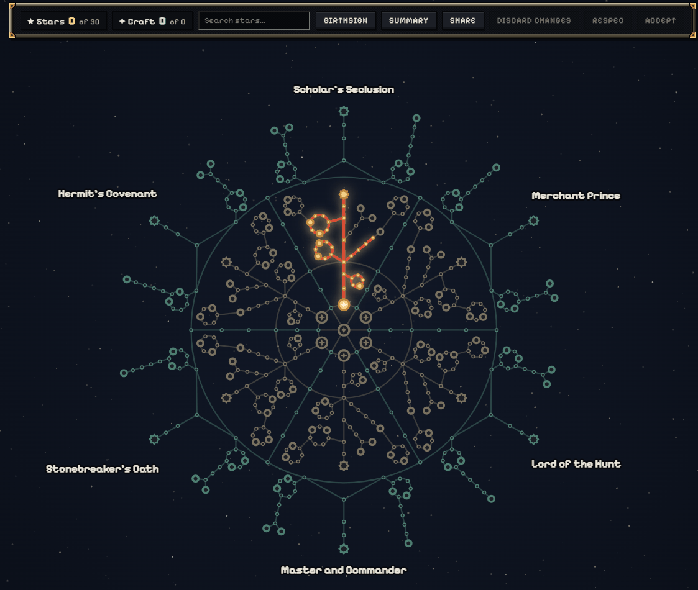

> [!NOTE]
> The initial commit of this page was prepared with the assistance of AI tools. Readers are encouraged to verify the information against the game and official sources, and to contribute corrections and improvements.
>
> **Applies to:** Daggerfall Online, online mode. Verified against Update 0.0.466 (`app-v0.1.12948`), 28 October 2026.

## Overview

Firmament is a passive progression system in Daggerfall Online. Its tree contains 518 interconnected stars that provide bonuses to combat, magic, professions, trade, and exploration.

A character develops their allocation by selecting a birthsign and spending points along connected paths. Firmament is accessed through **Pause Menu → Growth → Firmament**.

{center 900}

## Terminology

The game uses *star* for both an element of the tree and a type of spendable point.

| Term | Meaning |
|---|---|
| Stars | Points earned through Renown progression |
| Craft points | Points earned through profession progression |
| Combat stars | Gold-coloured nodes in the inner part of the tree |
| Craft stars | Green-coloured nodes in the outer part of the tree |
| Birthsign | One of seven starting stars |

## Earning points

| Points | Acquisition | Allocation | Maximum |
|---|---|---|---|
| Stars | 2 for each [[Renown]] level after level 1 | Any star | 98 at Renown 50 |
| Craft points | 1 for every 8 combined profession ranks | Craft stars only | 125 |

Profession ranks are summed across all ten [[topic:Professions]], each with a maximum rank of 100. When Craft stars are allocated, available Craft points are spent before Stars.

The point balances appear at the top of the Firmament window.

## Birthsigns and paths

### Birthsigns

A character selects one of seven birthsigns. Six are arranged around the inner tree, while The Serpent is located at its centre. The initial selection is free.

| Birthsign | Combat focus | Non-combat focus |
|---|---|---|
| The Mage | Intelligence, spell damage, and casting | Enchanting and Medical |
| The Shadow | Stealth, illusion, and surprise attacks | Trading and social skills |
| The Thief | Archery, Agility, and evasion | Hunting, outfitting, and climbing |
| The Steed | Speed, melee combat, and stamina | Sailing, fishing, and travel |
| The Warrior | Strength, weapons, and armour | Mining, logging, smithing, and building |
| The Ritual | Restoration, Willpower, and combat against undead | Herbalism, provisioning, and environmental resistance |
| The Serpent | Access to several combat branches | Connections to different areas of the tree |

### Paths

Every allocated star must be connected to the selected birthsign. Selecting an unallocated star adds the shortest available path to it, including any required intermediate stars, provided the character has enough points.

Paths cannot pass through another birthsign or continue through a keystone.

Changes remain provisional until **Accept** is selected. **Discard changes** restores the last accepted allocation. The **Summary** panel displays the combined bonuses of the current selection.

### Controls

| Action | Control |
|---|---|
| Inspect a star and preview its path | Mouse hover |
| Allocate a star and its required path | Left-click |
| Remove an allocated star | Right-click |
| Pan across the tree | Mouse drag |
| Zoom | Mouse wheel |
| Centre on the selected birthsign | `F` |
| Find stars by name or effect | **Search** |

## Refunds and respecs

### Refunds

Removing an allocated star also removes any stars that depend on it for their only connection to the birthsign. The confirmation displays the number of affected stars and the total cost.

| Renown | Cost per removed accepted star |
|---|---|
| Below 10 | Free |
| 10 or higher | 10 silver |

Stars added only in the current, unaccepted preview can be removed without charge.

### Respecs

The **Respec** action removes the birthsign and all allocated stars, returning their points. A full respec costs **10,000 gold**, with no additional silver charge. Payment is taken from carried gold first, followed by banked gold.

Right-clicking the selected birthsign also clears the planned allocation so another can be chosen. Unlike a full respec, this follows the normal refund rules when previously accepted stars are removed.

## Build sharing

Firmament allocations can be exported and imported using build codes beginning with `FIRM-`.

### Exporting

Open **Share** and select **Copy**. The code represents the allocation currently displayed in the window, including unaccepted changes.

### Importing

Paste a code into **Load a build code** and select **Load**. The imported allocation must match the current Firmament tree and fit the character's available points. Review the result and select **Accept** to save it.

## Bonuses

### Combat bonuses

Combat stars can improve attributes and combat skills, weapon and spell damage, casting speed and spell costs, maximum Health and Spell Points, regeneration, armour, resistances, evasion, and other defensive abilities. Some effects depend on the enemy type or the conditions of a fight.

### Crafting and trade bonuses

Craft stars can improve gathering yields, profession experience, non-combat skills, carrying capacity, sailing, travel, and environmental resistance.

## Restrictions

### Offline mode

> [!IMPORTANT]
> All Firmament bonuses are inactive in offline mode, including combat, crafting, trade, and exploration effects.

Firmament depends on the online account service. Its bonuses are also inactive in a session that has lost the account's active online seat to another tab or device.

### Duels and Arena

> [!IMPORTANT]
> All Combat star bonuses are disabled during duels and Arena fights, not only bonuses to damage.

The restriction includes combat attributes and skills, additional maximum Health and Spell Points, regeneration, armour, resistances, evasion, casting speed, spell costs, and other combat-related effects. Craft star bonuses remain active while the character is online.

### Open-world PvP and sieges

Combat stars are not globally disabled in open-world PvP areas or sieges. General effects, including modifications to attributes, maximum Health and Spell Points, and spellcasting, can remain active outside duels and Arena fights.

However, **weapon attacks and spells targeting another player are calculated without Firmament bonuses**. This excludes Firmament's contributions from the relevant player-targeted attack calculations; it does not mean that every combat-related character effect is deactivated throughout the area.

Player damage also follows separate PvP rules. Player attacks remove a proportion of the defender's Health, so additional maximum Health does not automatically provide the same protection against players that it provides against non-player enemies.

Combat bonuses continue to apply against monsters in PvP-enabled areas, including the Wrothgarian Mountains. Defeating another player does not trigger Firmament's Health or Spell Point recovery effects associated with defeating enemies.

### Mentoring

Combat star bonuses are reduced according to the mentoring system's power scale. Craft star bonuses retain their full strength.

### Bonus caps

Firmament limits the combined contribution of allocated stars, including larger stars with specialised bonuses.

| Effect | Maximum Firmament contribution |
|---|---|
| General weapon damage | +30% |
| Weapon damage, including situational bonuses | +50% |
| Spell damage | +30% |
| Spell cost reduction | 25% |
| Attribute increase | +15 |
| Damage reduction | 15% |

Firmament can increase attributes beyond their normal maximum of 100, subject to the applicable bonus cap.

### Online status

The Summary panel can display the bonuses of an allocation even when they are inactive. Its status message identifies an offline session, unloaded server data, an unaccepted birthsign, a duel or Arena fight, mentoring, or an active tree.

The online account service validates accepted changes, including point balances, connections, and refund costs. Invalid allocations are rejected.

## Sources

The implementation was verified against Update 0.0.466 (`app-v0.1.12948`).

- [Firmament tree and birthsigns](https://github.com/Lattymoy/daggerfall-js-source/blob/app-v0.1.12948/src/net/firmament/firmamentTree.js)
- [Points, allocation rules, refunds, and caps](https://github.com/Lattymoy/daggerfall-js-source/blob/app-v0.1.12948/src/net/firmament/firmamentLaw.js)
- [Interface, controls, and terminology](https://github.com/Lattymoy/daggerfall-js-source/blob/app-v0.1.12948/src/ui/firmamentWindow.js)
- [Online status and mentoring](https://github.com/Lattymoy/daggerfall-js-source/blob/app-v0.1.12948/src/systems/firmamentLive.js)
- [Combat effects and PvP restrictions](https://github.com/Lattymoy/daggerfall-js-source/blob/app-v0.1.12948/src/systems/firmamentPowers.js)
- [Server-side validation and respecs](https://github.com/Lattymoy/daggerfall-js-source/blob/app-v0.1.12948/server-account/src/firmament.js)
- [Update 0.0.461: Player fights](https://github.com/Lattymoy/daggerfall-js-source/releases/tag/app-v0.1.12919)
