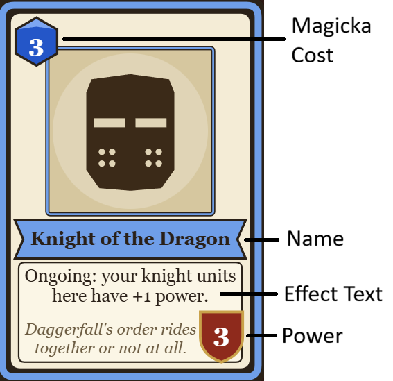
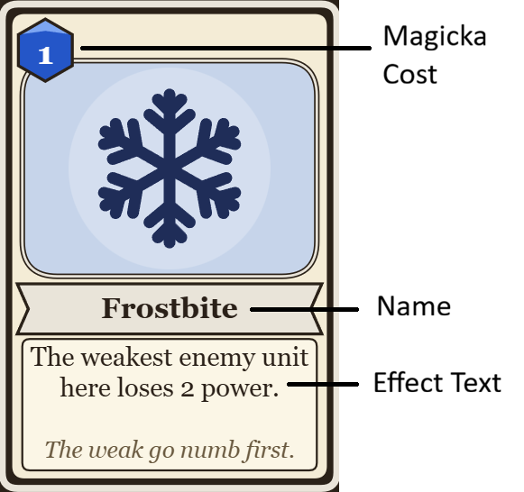
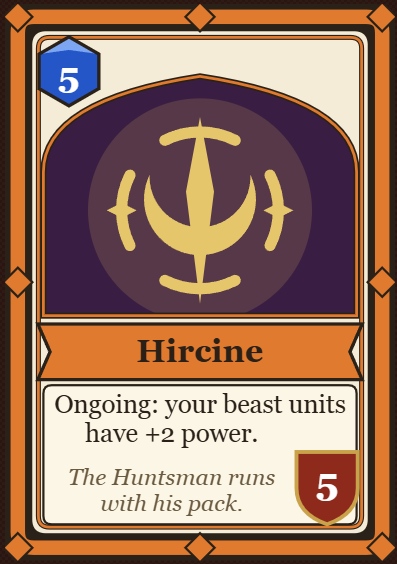
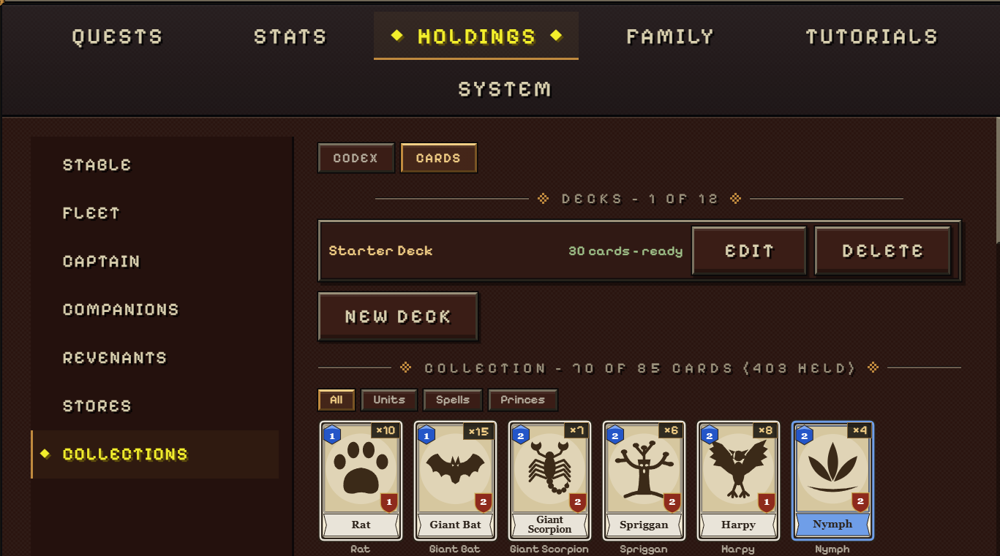
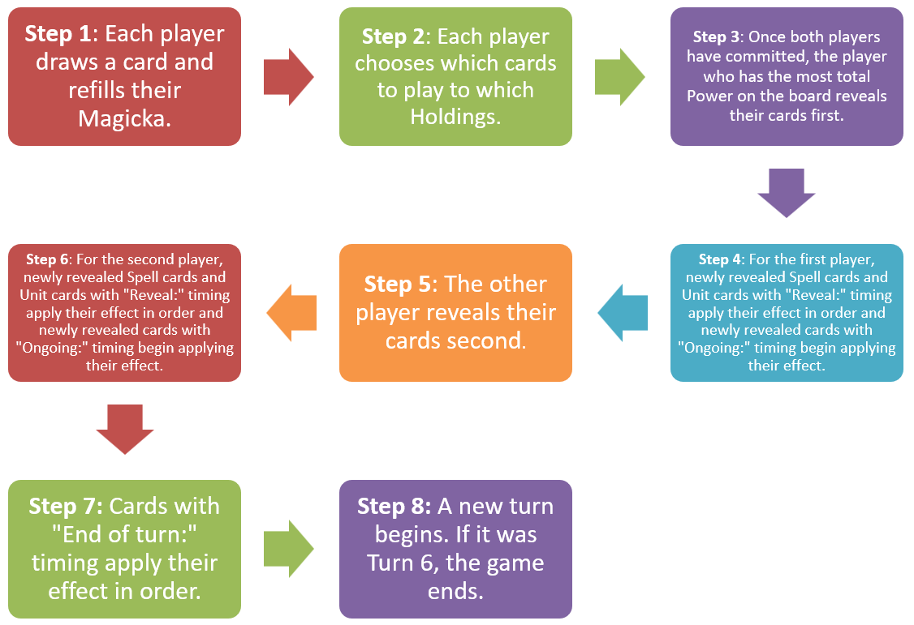
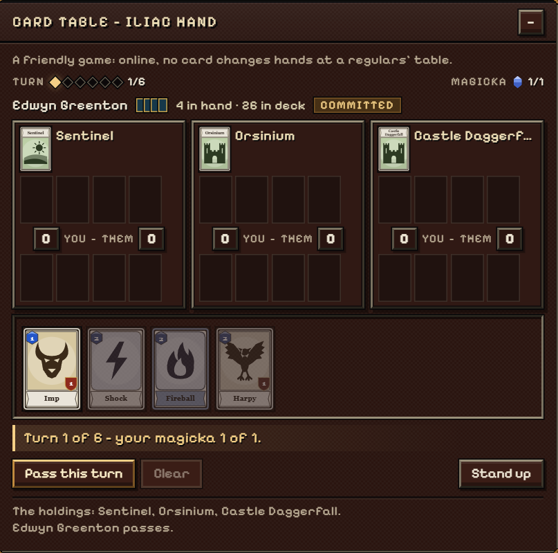
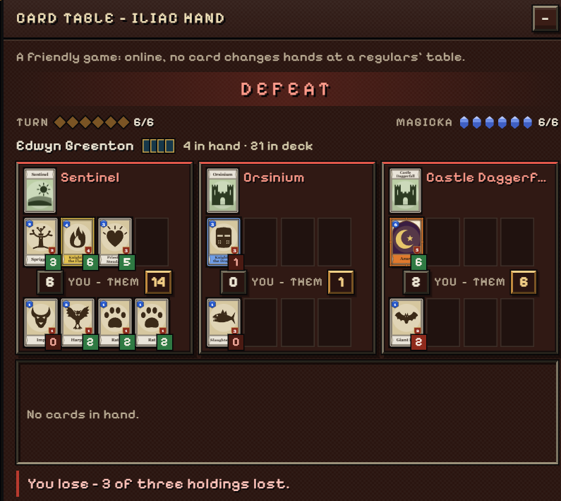

## Overview

Iliac Hand is a two-player card game playable in taverns in DFO Online against other players or NPCs. Players compete over three Holdings by the end of Turn 6. If neither player does, the player with more total Power on the board wins (see Scoring).

## Card Types

### Unit Cards

Unit cards are played to Holdings and remain active for the rest of the game. Each Unit card contains the following plus a line of flavor text that has no effect on play:

**Magicka Cost:** The amount of Magicka you must pay to play this card to a Holding.

**Name:** The name of the card. A deck may contain two copies of a card (one copy if it is Legendary rank).

**Effect Text:** Text that affects various aspects of the game, from adding or subtracting Power to bringing additional cards into play. Depending on the key word at the start of the Effect Text, effects can be Ongoing, Reveal or End of Turn.

- Ongoing effects apply continuously after the card is revealed and end immediately if it is destroyed.
- Reveal effects trigger once when the card is revealed and changes made persist even if the card is destroyed.
- End of Turn effects trigger once at the end of each turn and changes made persist even if the card is destroyed.

Effect Text may refer to categories of Unit cards such as knight units and orc units. A Unit card may belong to more than one category. There is currently no way to view in-game which categories a Unit card belongs to.

**Power:** A measure of the Unit card's strength. The player with more cumulative Power in a Holding across all their Unit cards at the end of the game wins that Holding. A Unit's Power can never go below 0.

### Spell Cards

Spell Cards are played to Holdings but are discarded immediately after they take effect. Each Spell card contains the following plus a line of flavor text that has no effect on play:

**Magicka Cost:** The amount of Magicka you must pay to play this card to a Holding.

**Name:** The name of the card. A deck may contain two copies of a card (one copy if it is Legendary or higher).

**Effect Text:** Text that affects various aspects of the game, from adding or subtracting Power to bringing additional cards into play. Spells apply their effects using the same timing as Unit cards with "Reveal:" effects.

Artifacts, such as Chrysamere and Wabbajack, are especially powerful Spells with a unique card border.

### Prince Cards

Prince cards, while occupying a separate tab in your Collection, function identically to Unit cards. Unlike Unit cards which can only affect the Holding they are in, each Prince card has an **Ongoing:** effect that affects the entire board.

## Holdings

The board is made up of three Holdings where cards can be played. Each Holding has its own effect. These three Holdings are randomly selected out of a pool of eleven at the beginning of the game, each with their own effects. A Holding can hold up to four total Unit and Prince cards on each side. Cards that move to the “next” Holding, such as Giant Bat, will move to the Holding to the right of their current one, wrapping around to the first Holding if they are currently on the third Holding.

| Holding           | Card Text                                                                                       |
| :---------------- | :---------------------------------------------------------------------------------------------: |
| Daggerfall        | Knight units here have +2 Power.                                                                |
| Sentinel          | Units here that cost 1 or 2 have +1 Power.                                                      |
| Wayrest           | Each side holds only three cards here.                                                          |
| Shornhelm         | End of Turn: The weakest Unit on each side here loses 1 Power.                                  |
| Orsinium          | Orc units here have +2 Power.                                                                   |
| Betony            | After a card is revealed here, its owner draws a card.                                          |
| Evermor           | After a card is revealed here, its owner gains 1 Magicka next turn.                             |
| Castle Daggerfall | Spells cannot be played here.                                                                   |
| Privateer's Hold  | Cards here are played face down and unveiled when the game ends. Spells cannot be played here.* |
| Mages Guild Hall  | Spells played here cost 1 less.                                                                 |
| Vampire's Crypt   | Undead units here have +2 Power.                                                                |

*Face-down cards never activate their Effect Text. At the end of the game, they count their printed Power plus any bonuses that cards from other Holdings give them. A card moved into this Holding remains face- up.

## Deckbuilding

To build a deck, open the Holdings menu on the pause screen, select the Collections tab and then the Cards sub-tab. There, you can view your card collection and select New Deck to create a deck.

### Deck Rules

- A deck must contain exactly 30 cards.
- A deck may contain up to two copies of a card. Legendary or higher cards (Legendary, Aetheric, Artifact, and Gilded rarity) are limited to one copy.

### Obtaining Cards

There are three ways to obtain Iliac Hand cards:

1. You can purchase a Card Pack from any tavernkeeper in the Iliac Bay by speaking to them or clicking the Purchase Pack button while sitting down at a table. The price varies from 20 to 35 Gold depending on the tavern. A Card Pack can be opened from your inventory and contains five random cards, the last of which is guaranteed to be of Rare rarity or higher.
2. You may receive a card as an additional reward when turning in a quest for a Guild, Knightly Order or Temple. This card will be of the faction that you did a quest for.
3. Enemies rarely drop their own card when killed.

## Gameplay

### Game Setup

- Three Holdings are selected at random.
- Each player shuffles their deck and draws four cards to form their starting hand.
- Player 0 and Player 1 are selected. Online, Player 0 is the player who sat down first. A coin is flipped internally to decide who reveals first when Power is tied (see Step 3 of Playing the Game).

### Step 1

You do not draw a card on Turn 1. You do not draw a card if you already hold 7 cards or if all cards have already been drawn from your deck.

Your Magicka equals the turn number (3 on Turn 3) plus any bonus Magicka you received from card effects or Holdings last turn, up to a maximum of 10. Unspent Magicka does not carry over and bonuses last for one turn only.

{center 404}

### Step 2

You can only play cards if you have enough Magicka to pay for their cost. You can play cards to any Holding and in any order you desire but only to the limit of 4 total Unit and Prince cards (3 for Wayrest). Spells do not count towards this limit. You cannot change your choice after selecting Commit. You can see your opponent's number of cards in hand and deck, Magicka count and whether they have committed but you cannot see the cards they play.

 and Slaughterfish (costing 2) to two Holdings. Although this is turn 2, the player played Imp last turn, increasing their Magicka by 1 this turn. Notice how Imp’s power is boosted by 1 due to the effect of the Sentinel Holding."){center 405}

### Step 3

The player who currently has the most cumulative Power across the board reveals their cards. If this is tied, which is always the case on Turn 1, the result of the coin flip at Game Setup is used (see Game Setup). The player who will go first during a tie alternates each turn starting with this result.

### Step 4

Cards are revealed, and therefore apply their effects, in the order they were listed. Spells are discarded after their effect applies. Holdings which take effect when a card is revealed, such as Evermor, apply at this stage.

### Step 5

The other player now reveals the cards they played during Step 2.

### Step 6

The second player's cards are revealed and apply their effects in the same way.

### Step 7

Every card with "End of turn:" timing now applies its effect from the leftmost Holding first. Within a Holding, cards belonging to the player who revealed first this turn apply first from oldest to newest. After all cards within a Holding have applied their effects, the Holding applies its own "End of turn:" effect (currently, only Shornhelm has one) before continuing to the next Holding and its cards.

![On the last turn, the bottom player played Harpy and Slaughterfish while the top player played Spriggan. Since the bottom player had more cumulative power at the beginning of that turn (see the previous image), their cards were revealed first. Harpy has a “Reveal:” effect, so it applied its effect during Step 4. However, since the bottom player revealed first, the opponent had no Unit cards yet for Harpy to weaken. On the other hand, when the top player revealed Spriggan, it was able to apply its effect to strengthen itself during Step 6. Since Sentinel, like most Holdings, is a continuous effect, Spriggan’s Power was raised by 1 even before it raised its own Power allowing to reach 4. Unit cards with “Ongoing:” effects follow the same rule. Finally, during Step 7, Slaughterfish’s “End of turn:” effect triggered to decrease its power.](./images/iliac-hand-step-7.png "On the last turn, the bottom player played Harpy and Slaughterfish while the top player played Spriggan. Since the bottom player had more cumulative power at the beginning of that turn (see the previous image), their cards were revealed first. Harpy has a “Reveal:” effect, so it applied its effect during Step 4. However, since the bottom player revealed first, the opponent had no Unit cards yet for Harpy to weaken. On the other hand, when the top player revealed Spriggan, it was able to apply its effect to strengthen itself during Step 6. Since Sentinel, like most Holdings, is a continuous effect, Spriggan’s Power was raised by 1 even before it raised its own Power allowing to reach 4. Unit cards with “Ongoing:” effects follow the same rule. Finally, during Step 7, Slaughterfish’s “End of turn:” effect triggered to decrease its power."){center 387}

### Step 8

The turn ends and a new one begins. If it was Turn 6, the game ends and proceeds to Scoring.

{center 398}

### Scoring

At the end of Turn 6, the player with more Power in a Holding controls it. If Power is tied, neither player controls that Holding. A player who controls two or more Holdings wins. If there is none, the player with more total Power across all three Holdings wins. If total Power is also tied, the game is a draw.

| Case | Holding 1                   | Holding 2                   | Holding 3                    | Result                                                                         |
| :--- | :-------------------------: | :-------------------------: | :--------------------------: | :----------------------------------------------------------------------------: |
| A    | P0 9 vs. P1 6 (P0 controls) | 4 vs. 4 (tied)              | P0 3 vs. P1 8 (P1 controls)  | One Holding each. Total Power is 16 to 18, so Player 1 wins on total Power.    |
| B    | P0 5 vs. P1 4 (P0 controls) | P0 5 vs. P1 4 (P0 controls) | P0 0 vs. P1 20 (P1 controls) | Player 0 controls two Holdings and wins, even though total Power is 10 to 28.  |
| C    | P0 6 vs. P1 4 (P0 controls) | P0 3 vs. P1 5 (P1 controls) | 7 vs. 7 (tied)               | One Holding each and one tied. Total Power is 16 to 16, so the game is a draw. |

### Online Play

When playing against other humans, both players have 45 seconds to commit to their plays. A player who runs out of time passes their turn. Passing three turns in a row in this way or leaving the table concedes the game. In a ranked game, a player who leaves the table has a 15-second grace period to return. After a game ends, a rematch begins 8 seconds later if both players are still seated. Ranked games can only be played between characters on different accounts and using decks the account service has vouched for (every card in the deck is owned by the account’s character) and count towards the ranking ladder. Friendly games do not have these restrictions.

## Card List
