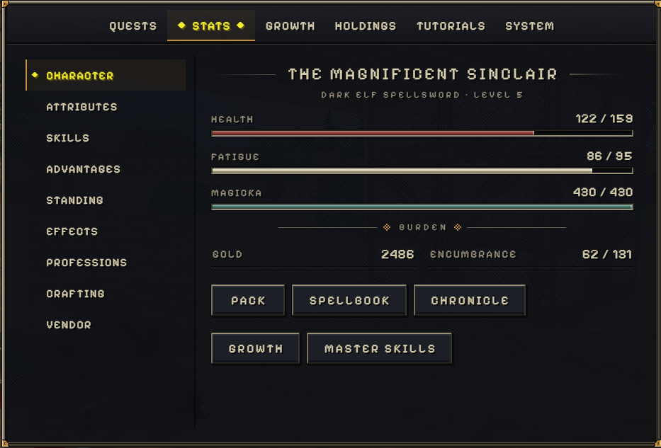
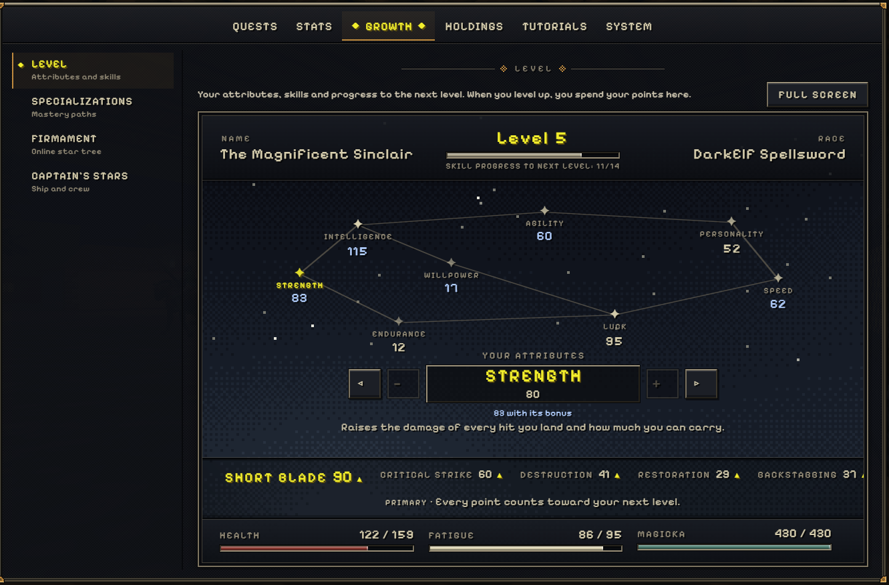
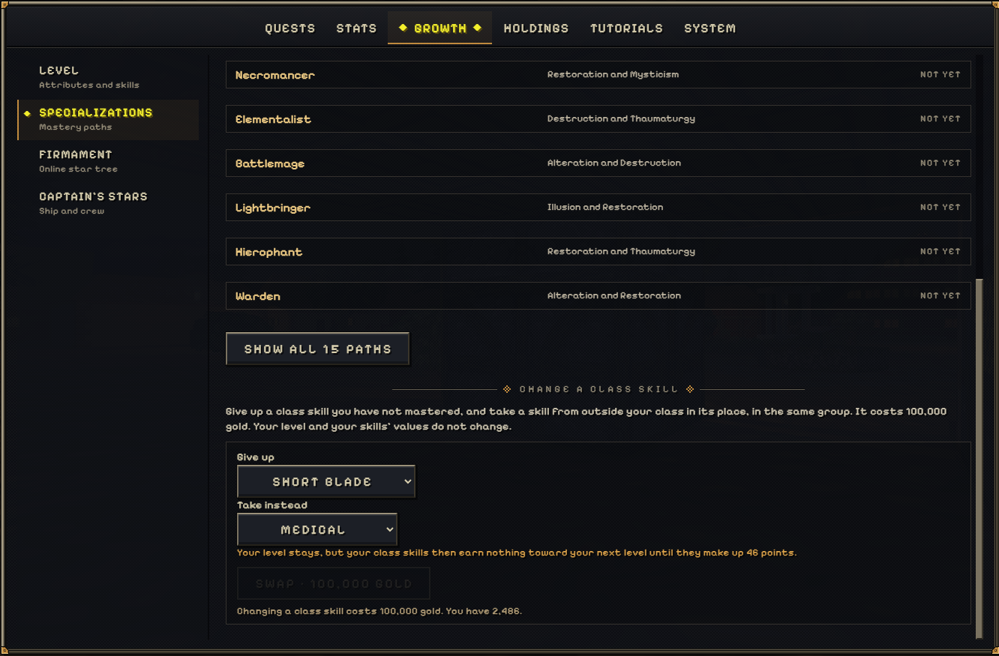
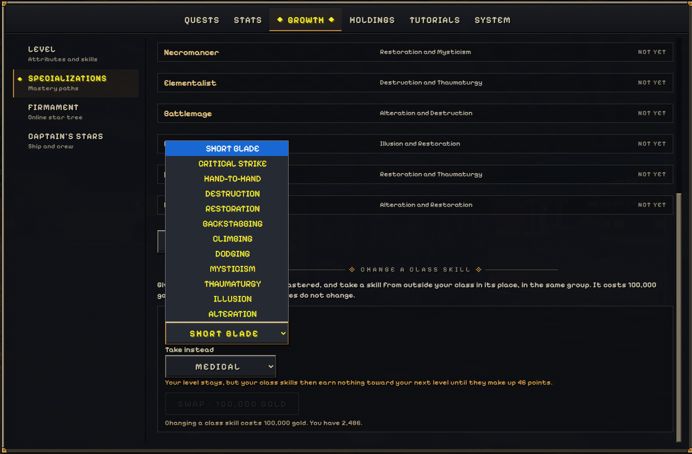

> [!NOTE]
> **Applies to:** *Online*. As of patch *0.0.449* Which released on *2026/10/27*
 This page goes in to detail about Skills and their Limitations and Benefits.

## Limits and things to know
- There are a total of 35 Skills
- The max cap of skills that aren't [[topic:Master Skills]] is 100
- Skills that have not been Mastered can be swapped for 100,000 gold.
- Schools of Magic Skills decrease the magicka cost of spells as they are leveled.

---
## Skills

### Martial (8)
- Archery
- Axe
- Back-stabbing
- Blunt Weapon
- Critical-Strike
- Hand-to-Hand
- Long Blade
- Short Blade

### Arcane (6)
- Alteration
- Destruction
- Illusion
- Mysticism
- Restoration
- Thaumaturgy

### Defensive (2)
- Dodging
- Medical

### Language (9)
- Centaurian
- Daedric
- Dragonish
- Giantish
- Harpy
- Impish
- Nymph
- Orcish
- Spriggan

### Social (2)
- Etiquette 
- Mercantile

### Thievery (2)
- Lockpicking
- Pickpocketing

### Movement (4)
- Climbing
- Jumping
- Running
- Swimming

## Swapping Skills
### Notes
- If you swap Primary (A) for Miscellaneous (B) the swap will put (B) as Primary and (A) in Miscellaneous.
  - If you have a Primary as Short-Blade and swap it out for Miscellaneous Medical, Medical will take the spot of Short-Blade in Primary.
 
### Requirements
- Only skills that haven't been mastered can be swapped
- Changing a skill costs 100,000 gold.
  
### Step 1 
Press F5 This should open the Stats Tab check [[Controls]] if not.
 {left 400}
### Step 2
Click on over to the Growth Tab at the Top 
 {left 400}
### Step 3
Click on Specializations on the left hand side of the menu and scroll down.
 {left 400}
### Step 4
You can now see the "Give Up" and "Take instead" drop-downs click them to see your options.
 {left 400}

## Sources
*In-Game Menu's, Stats, Growth and Specializations*

*Patch 0.1.8151 released on 2026-10-12*