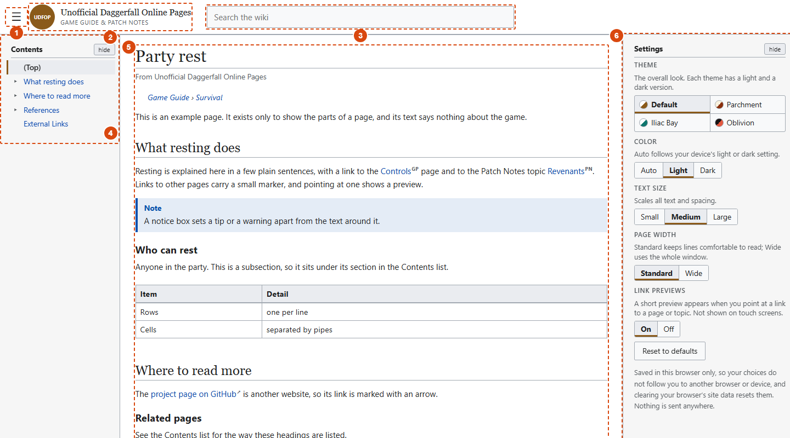
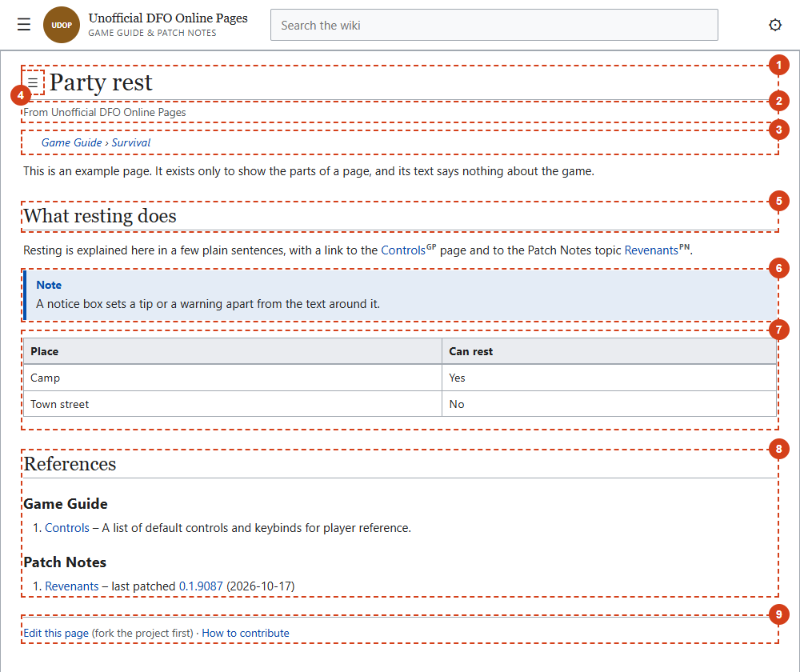
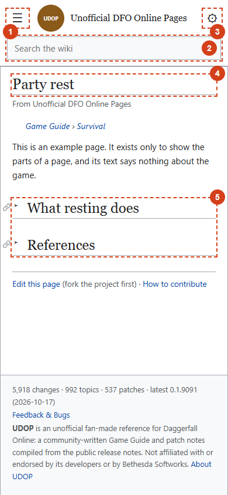

A Game Guide page looks like more than the file you wrote. The site builds a title block, a Contents list, a References section and more around your text. This page names each part, so you know what you control and what you leave to the site. For the steps of writing a page, see [[How to write a guide page]].

## The whole screen

{center 900}

1. **The Main menu button.** The main menu is hidden until the reader opens it with this button.
2. **The logo.** It links to the Main Page.
3. **The search box.**
4. **The left sidebar**, which holds the Contents list, and the main menu if the reader docks it there.
5. **The page.** This is the only part you write.
6. **The right sidebar**, which holds Settings.

Readers choose which of these are shown, and how wide the page is. See [[Using the site]].

## The page itself

{center 760}

From the top of the page down. The numbers match the picture.

| # | Part | Where it comes from |
|---|---|---|
| 1 | **Title** | Your `title` line. If your text starts with a heading that repeats the title, the site drops it. |
| 2 | **"From Unofficial Daggerfall Online Pages"** | Added by the site on every page. |
| 3 | **Breadcrumb** | Built from your `category`: Game Guide › your category, with both parts linked. A page with `unlisted: yes` has none. |
| 4 | **Contents button (☰)** | Added by the site, and shown only when the reader has not docked Contents in the sidebar. It sits beside the title, and once the reader scrolls past the title it floats at the top left of the window. It opens the Contents as a pop-up. |
| 5 to 7 | **Your text** | Everything you wrote below the front matter. Here it is a section heading (5), a notice box (6) and a table (7). Each `##` and `###` heading also becomes an entry in the Contents list. |
| 8 | **References** | Built from the links in your text and your `related` line. |
| 9 | **Edit line** | "Edit this page (fork the project first) · How to contribute." Added by the site. |
| 10 | **Footer** | The change, topic and patch counts, the Feedback & Bugs link and the disclaimer. Added by the site. |

## On a narrow screen

{right 240}

On a phone, or any window under about 860 pixels wide, the page is one column and the sidebars are gone:

- **There is no Contents list.** Instead, each `##` and `###` section **folds**, closed to begin with. Tapping a heading opens it.
- **The Main menu and Settings** open as pop-ups from the header buttons.
- **Floated pictures** move above the text and take the full width.

## Where to read more

- How to write each part of your text: the [[Formatting reference]].
- What readers can change, and how the menus work: [[Using the site]].

Back to the [Site Guide](#/site).
