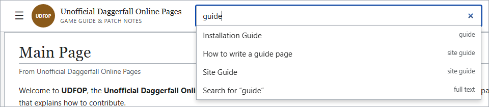
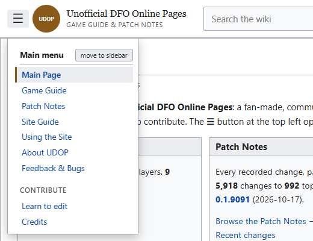
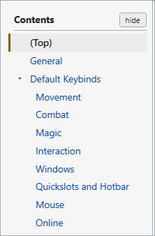
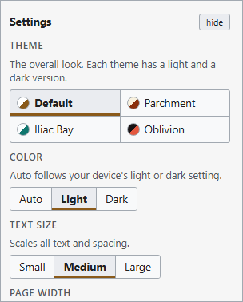
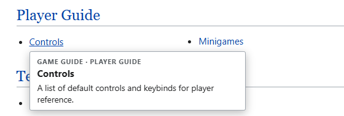
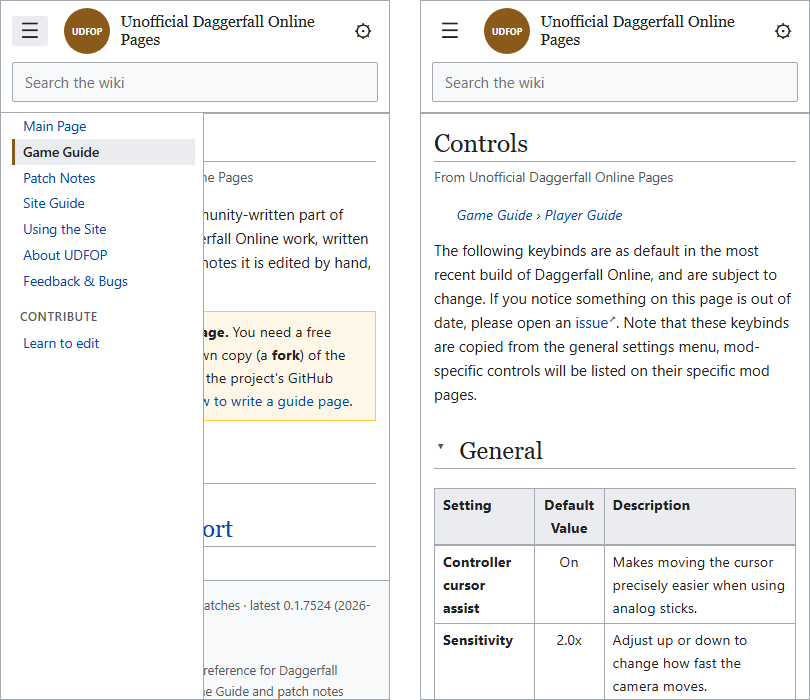

This page is for readers. It explains how to find things on UDOP with search and browsing, how the menus work, and how to change the look in Settings. Nothing here needs an account, and your choices stay in your browser.

The site has two parts, the [Game Guide](#/guide) and the [Patch Notes](#/patchnotes), described on the [Main Page](#/). They are connected only by links: a guide page can link to a Patch Notes topic, but Patch Notes pages do not list guide pages.

## Finding things

### The search box

The search box is at the top of every page. As you type, it suggests matching Game Guide pages, Site Guide pages and Patch Notes topics, with a "Search for" line at the bottom for the full search.

{center 680}

- Press {{Down}} and {{Up}} to move through the suggestions, and {{Enter}} to open the highlighted one.
- Press {{Enter}} with a topic's exact name typed to go straight to that topic.
- Press {{Enter}} with anything else to see the full results.
- The full results show Game Guide pages first, then Site Guide pages, matching topics and matching changes. Every word you type must appear. Guide pages whose title contains your words come first.
- Long lists of guide pages and topics show the first part and a "Show the other…" button for the rest. The table of changes shows the 100 newest matches and says how many older ones are not shown, so add a word to narrow it.

### Browsing the Patch Notes

The [Patch Notes](#/patchnotes) front page has a **Browse** line: Recent changes, All topics, Areas, Patch index and Random topic. Use **Random topic** to wander. The **Recent changes by type** box on that page has a tab for each kind of change (Additions, Reworks, Fixes and so on). Each tab is a small table of the five newest patches that made that kind of change: how many, which topics, and a link to that patch's section for them.

A patch page and the Recent changes page sort the changes by kind first: Additions, Reworks, Fixes, then performance, economy, interface, balance, removals and other changes, so you can read what is new without the fixes mixed in. Each heading shows how many changes it holds and appears in Contents. Above the list, the **By type** and **By topic** tabs switch between that and the older layout, one heading per topic. The patch page also links to the developers' original release notes on GitHub.

### Browsing the Game Guide

The [Game Guide](#/guide) lists pages under their categories, with the first dozen in each. Choose a category name for the whole list, where pages are in alphabetical order. Pointing at a page's link on a computer shows its summary.

## The menus

### The main menu

The main menu lists the main pages: Main Page, Game Guide and Patch Notes under **Read**; the Site Guide (which includes this page) and Feedback & Bugs under **Help**; and **How to write a page**, **Open the editor** and **About & Credits** under **Contribute and about**. About & Credits also names the people behind UDOP.

It starts hidden. Open it with the **☰** button at the top left of the header. Inside it, the **move to sidebar** button docks it as a permanent sidebar on the left, and the **hide** button puts it away again.

{right 300}

### Contents

Every page with headings has a **Contents** list. It starts docked in the left sidebar. It begins with **(Top)**, which takes you back to the start of the page. Sections with subsections have a small arrow at the left, and you open one to see its subsections. The section you are reading is highlighted.

{right 190}

Hide it with its **hide** button, and a **☰** button appears beside the page title. It opens the Contents as a pop-up, and it floats at the top left of the window once you scroll past the title. Choosing an entry does not close the pop-up. Press {{Esc}} or click elsewhere to close it.

### Settings

On a wide window, Settings starts docked in the right sidebar, and the **⚙** gear is not shown in the header. Press its **hide** button to put it away, and the gear appears at the top right. The gear opens Settings as a pop-up, which has a **move to sidebar** button to dock it again. On a narrow window, Settings is always a pop-up from the gear.

{center 300}

| Setting | Choices | What it does |
|---|---|---|
| **Theme** | Default, Oblivion, Iliac Bay, Town Crier, Phosphor, Cassette | The overall look. Each has a light and a dark version, except Phosphor, which is always dark. |
| **Color** | Default: Gold, Parchment, Slate, Moss, Dusk, Terracotta, Graphite. Phosphor: Capital Wastes, Mojave, Anchorage, White | Shown only for the Default and Phosphor themes. For Default it is the whole color scheme, in light and dark; for Phosphor it is the screen color. |
| **Mode** | Auto, Light, Dark | Auto follows your device's light or dark setting. |
| **Text size** | Small, Medium, Large | Scales all text and spacing. |
| **Page width** | Standard, Wide | Standard keeps lines comfortable to read. Wide uses the whole window. |
| **Top bar** | Stays visible, Scrolls away | Stays visible keeps the top bar on screen while you scroll. Scrolls away lets it move off the screen, so the page has more room. |
| **Link previews** | On, Off | A short preview when you point at a link to a page or topic. Not shown on touch screens. |

**Reset to defaults** at the bottom puts everything back, including where the sidebars sit.

> [!NOTE]
> Your choices are saved in this browser only. They do not follow you to another browser or device, and clearing your browser's site data resets them. Nothing is sent anywhere.

## Reading a page

### Links

A small marker after a link says where it goes.

| Marker | Where the link goes |
|---|---|
| **GP** | a page in the Game Guide |
| **SG** | a page in the Site Guide |
| **PN** | a Patch Notes topic or patch |
| **↗** | another website |

A link with no marker goes to another part of this site, such as a category. A **red** link is a page nobody has written yet. Clicking it starts that page on GitHub.

### Previews

On a computer, pointing at a link to a page, topic, patch, area or category shows a short preview card. Turn previews off in Settings if you find them distracting.

{center 620}

### Pictures

Click any picture to open it, fitted to the window. A page with several pictures opens them as a carousel: use the **‹** and **›** buttons, the {{Left}} and {{Right}} keys, or a swipe on a touch screen to move through them, and the count at the top left shows where you are. Click the picture to zoom in, and once more to zoom out. When it is zoomed in, scroll to move around it. To close it, click the dark area around it, press {{Esc}}, or use the **×** button. With the keyboard, {{Tab}} to a picture and press {{Enter}} to open it, and {{Enter}} again to zoom.

### Where you were

The site remembers how far down each page you had scrolled. Press your browser's **Back** or **Forward** button, or reload the page, and you return to the same spot. A link you click starts at the top of the new page. The memory lasts as long as the browser tab is open.

### Keys and spoilers

Keys and buttons are drawn as keycaps, such as {{W}} or {{Shift+Right click}}. Gamepad buttons are round: {{pad:RT}}. A dark bar over some words is a **spoiler**. Click it, or press {{Enter}} or {{Space}} while it is selected, to show it, and do the same to hide it again.

### Code boxes

A box with a bar on top holds code or a command. The bar shows the language when the writer gave one, and the **Copy** button copies the text exactly as written, without the colors.

## On a phone or a narrow window

Under about 860 pixels wide, the site becomes one column.

- The main menu and Settings open as pop-ups from the header buttons.
- There is no Contents list. Instead, the sections of a page fold, closed to begin with, and you tap a heading to open it.
- A floated picture moves above the text.

{center 600}

## Keyboard

- {{Tab}} moves between links and buttons, and {{Enter}} follows one.
- {{Esc}} closes whichever pop-up is open: the suggestions list, the main menu, Contents, Settings or a link preview.

Back to the [Site Guide](#/site).
